<h1 align="center">Profile Forge</h1>

<p align="center">
  <em>A Go command-line tool that generates a GitHub profile README and a portfolio JSON document from live repository metadata and a small YAML config.</em>
</p>

<p align="center">
  <a href="https://github.com/adeoluo/profile-forge/actions/workflows/ci.yml"></a>
  <a href="https://github.com/adeoluo/profile-forge/releases"></a>
  
  <a href="LICENSE"></a>
</p>

---

## Motivation

A hand-written profile README drifts. Repositories get added, releases get cut,
descriptions change, and the diagrams stop matching the list below them. I
wanted the profile to be a build artifact: a reviewed config file is the source
of truth, the tool pulls current facts from GitHub, and a check command fails
when the committed README no longer matches what the config would produce.

profile-forge is a Go command-line tool that generates a GitHub profile README,
and optionally a portfolio JSON document, from live repository metadata plus
a small YAML config.

You describe the parts that only you know: your headline, how your repositories
group into categories, which ones are flagships and what validates them, and how
they connect. profile-forge fetches everything else from the GitHub REST API
(descriptions, languages, topics, stars, last push, latest release) and renders
one Markdown file with badges, mermaid diagrams, and tables. It then checks its
own output before writing it.

- **Live data:** paginated repository listing, the per-repository languages API,
  and latest releases, fetched by a bounded worker pool with an optional token.
- **Offline runs:** every response is stored in an on-disk cache with a TTL, so
  `--offline` reproduces the same README with no network access.
- **Diagrams that explain themselves:** a "find your path" flowchart and an
  ecosystem graph whose node colors come from the category config, plus a
  legend generated from the same config, so every color on the page is labeled.
- **Language breakdown:** bytes per language summed across repositories, shown
  as a table and a mermaid pie chart.
- **Self-checks:** no em or en dashes (the config is rejected if it contains
  them), every referenced repository must exist, mermaid blocks pass basic
  syntax checks, and `--check-links` requires every image URL to return HTTP 200.
- **Release engineering:** `make release` cross-compiles four targets, packs
  `tar.gz` archives, and writes `checksums.txt`.

The committed example [examples/adeoluo.README.md](examples/adeoluo.README.md)
is generated from [examples/adeoluo.yaml](examples/adeoluo.yaml) for the adeoluo
profile.

## Architecture

<p align="center">
  
</p>

<sub>Legend: amber = entry points and external systems, indigo = core logic, green = data and state, blue = validation and control, grey = observability and outputs.</sub>

`cli.Run` loads `profile.yaml` (dash scan, strict YAML, defaults, validation),
then the GitHub client fetches repositories, languages, and latest releases
through an on-disk cache, using a token from the environment or `gh auth token`
when one is available. `render.Build` assembles the view model and the mermaid
charts, a template renders each section, and the Markdown is validated (dashes
and mermaid syntax, optionally image links) before it is written or compared by
`check`. The same view model can also be written as `portfolio.json`.

| Package | Responsibility |
|---|---|
| `internal/config` | YAML schema, defaults, static validation, dash detection |
| `internal/github` | REST client, `Link` header pagination, token resolution, disk cache |
| `internal/render` | View model, language aggregation, mermaid builders, badges, template, JSON |
| `internal/validate` | Mermaid checks, output dash scan, image URL extraction and checking, coverage warnings |
| `internal/cli` | Commands and flags; all process dependencies injected for tests |
| `internal/fakegh` | A fake GitHub API used by the tests |

More detail in [docs/ARCHITECTURE.md](docs/ARCHITECTURE.md) and the decision
records in [docs/adr](docs/adr). The release process is in
[docs/RELEASING.md](docs/RELEASING.md).

## Results

### Benchmarks

Measured on an Apple M1 laptop with Go 1.27.3, generating
[examples/adeoluo.README.md](examples/adeoluo.README.md) (37 public
repositories, 7 categories, 11 flagships, 20 image URLs). Times are the
tool's own elapsed-time summary unless noted; three runs each.

| Scenario | API requests | Cache hits | Time |
|---|--:|--:|--:|
| Cold cache, authenticated | 75 | 0 | 2.57 s, 4.62 s, 5.69 s |
| Warm cache (6h TTL) | 0 | 75 | 59 ms, 76 ms, 85 ms |
| `--offline` | 0 | 75 | 5 ms, 6 ms, 9 ms |
| `check --offline --check-links` (20 shields.io URLs, 8 at a time) | 0 | 75 | 0.25 s, 0.31 s (process wall time) |

The cold run is dominated by GitHub API latency: one listing request plus two
requests per repository (languages, latest release) across 8 workers. The gap
between the warm and offline rows is the `gh auth token` subprocess, which
online runs use to find a token; with `GITHUB_TOKEN` set, a warm run took 5 ms.
The cache for this profile is 616 KiB on disk.

Rendering microbenchmarks (`make bench`) on synthetic portfolios, covering
`Build`, template execution, and output validation:

| Benchmark | Time per op | Memory per op | Allocations |
|---|--:|--:|--:|
| Build, render, validate: 40 repositories | 0.38 ms | 0.24 MB | 2,470 |
| Build, render, validate: 200 repositories | 1.29 ms | 0.86 MB | 7,099 |
| Aggregate languages: 200 repositories | 21 us | 2.0 KB | 11 |

Repository-to-category and flagship lookups go through maps built once per render, and the
string replacers used for badges, Mermaid labels and dash cleanup are built once per process
instead of on every call. Against the previous version that halved the time for 200
repositories (2.50 ms to 1.29 ms) and cut memory per render by 82%, with byte-identical output.

The stripped darwin/arm64 binary is 8.6 MB.

## Quickstart

### Install

From a release archive (macOS and Linux, arm64 and amd64):

```sh
VERSION=v0.1.0
OS=darwin ARCH=arm64   # or linux / amd64
curl -fsSLO "https://github.com/adeoluo/profile-forge/releases/download/${VERSION}/profile-forge_${VERSION}_${OS}_${ARCH}.tar.gz"
curl -fsSLO "https://github.com/adeoluo/profile-forge/releases/download/${VERSION}/checksums.txt"
shasum -a 256 -c checksums.txt --ignore-missing
tar -xzf "profile-forge_${VERSION}_${OS}_${ARCH}.tar.gz"
sudo install "profile-forge_${VERSION}_${OS}_${ARCH}/profile-forge" /usr/local/bin/
```

With Go 1.27 or newer:

```sh
go install github.com/adeoluo/profile-forge/cmd/profile-forge@latest
```

From source:

```sh
git clone https://github.com/adeoluo/profile-forge && cd profile-forge
make build   # writes bin/profile-forge
```

### First run

```sh
profile-forge init --out profile.yaml          # writes an example config for octocat
$EDITOR profile.yaml                             # set user, categories, flagships
profile-forge generate --config profile.yaml --out README.md --json portfolio.json
profile-forge check --config profile.yaml --readme README.md   # fails if README.md is stale
```

The example config from `init` works as is against the public `octocat`
account, so the first run succeeds before you edit anything.

Authentication is optional. profile-forge reads `GITHUB_TOKEN`, then `GH_TOKEN`,
then the output of `gh auth token`. Without a token, GitHub allows 60 requests
per hour, and a profile with 37 repositories needs 75 requests on a cold cache,
so a token is recommended for anything beyond a small account.

## Usage

A real run against the GitHub API, generating this account's profile README and checking every image link. Regenerate with `vhs docs/demo/generate.tape`.

<p align="center">
  
</p>

### Command reference

```
profile-forge generate --config profile.yaml --out README.md [--json portfolio.json]
profile-forge check    --config profile.yaml [--readme README.md]
profile-forge init     [--out profile.yaml] [--force]
profile-forge version
```

| Flag | Commands | Default | Meaning |
|---|---|---|---|
| `--config` | generate, check | `profile.yaml` | Path to the YAML config |
| `--out` | generate, init | `README.md` / `profile.yaml` | Output path; `-` writes to stdout |
| `--json` | generate | none | Also write the portfolio JSON document |
| `--readme` | check | none | Fail if this file differs from what generate would write |
| `--offline` | generate, check | false | Serve every API response from the cache, ignoring TTL; never touch the network |
| `--cache-dir` | generate, check | user cache dir + `/profile-forge` | Cache location |
| `--cache-ttl` | generate, check | `6h` | Reuse cached responses younger than this; `0` always refetches |
| `--check-links` | generate, check | false | Request every image URL; fail unless each returns HTTP 200 |
| `--template` | generate, check | built in | Custom `text/template` file (must define every section) |
| `--api` | generate, check | `https://api.github.com` | API base URL, for GitHub Enterprise Server or tests |
| `--diagrams-dir` | generate, check | none | Render the path, ecosystem and language charts to SVG files in this directory (relative to the README) and embed them as images; `check` also fails if the chart sources there are stale |
| `--mermaid-config` | generate, check | none | Mermaid configuration (theme, palette, shadows) passed to the renderer |
| `--mermaid-cmd` | generate, check | `npx -y @mermaid-js/mermaid-cli` | Renderer command; receives `-q -i <chart>.mmd -o <chart>.svg -b white [-c config]` |
| `--force` | init | false | Overwrite an existing config |

Exit codes: `0` success, `1` validation or runtime error, `2` usage error.
Progress, warnings, and a one-line summary (repositories, API requests, cache
hits, elapsed time) go to stderr; stdout carries only requested output.

`generate` and `check` print a warning for every public, non-archived,
non-fork repository that is not placed in a category and not listed under
`ignore`, so new repositories do not silently go missing from the profile.

### Config reference

```yaml
user: octocat                       # GitHub login whose public repos are fetched
name: The Octocat
headline: Example profile           # optional
bio: |                              # optional, Markdown
  One calm paragraph.
links:                              # optional, https only
  - {label: GitHub, url: https://github.com/octocat}
badges:                             # shields.io static badges
  - {label: built with, message: Go, color: "00ADD8", logo: go, style: for-the-badge}
stack:                              # optional rows of badges, one row per title
  - title: Languages
    items:
      - {message: Go, color: "00ADD8", logo: go}
sections: [header, stack, path, ecosystem, flagships, categories, languages, releases]
intro:                              # optional prose above sections
  path: ...
  flagships: ...
footer: Generated by profile-forge. # optional
categories:
  - id: web                         # [a-z][a-z0-9_]*; used for mermaid class names
    title: Web and pages
    color_name: blue                # legend word; defaults to the hex value
    color: "#dbeafe"                # node fill, required, #rrggbb
    stroke: "#1d4ed8"               # optional, defaults to color
    text: "#0b1b3a"                 # optional, defaults to #111827
    description: Static sites.
    repos: [Spoon-Knife, octocat.github.io]
flagships:
  - repo: Spoon-Knife               # must be in a category
    summary: Optional override of the GitHub description
    result: The one-line validation or result string
ecosystem:
  direction: LR                     # LR, RL, TD, TB, BT
  aliases: {octocat.github.io: pages site}
  edges:
    - {from: Hello-World, to: Spoon-Knife}
    - {from: Spoon-Knife, to: octocat.github.io, label: links to, style: dotted}  # solid, dotted, thick
languages:
  top: 6                            # rows beyond this fold into "Other"
  exclude_repos: []
  exclude_languages: []
  include_archived: false
path:
  prompt: What do you want to explore?
  max_others: 3                     # non-flagship repos listed per category node, one per line
  direction: TD                     # TD (categories side by side) or LR (one column)
  columns: 0                        # > 0: a grid of this many categories per row, without the root node
ignore: [hello-worId]               # public repos deliberately left out of categories
```

Validation rejects: unknown keys (typos surface instead of being ignored), em
dashes, en dashes and their HTML entities anywhere in the file (with line and
column), invalid logins, colors that are not `#rrggbb`, duplicate category ids,
a repository listed in two categories, flagships outside every category,
unknown sections, self edges, unknown edge styles, and edge labels containing
quotes or pipes. All problems are reported together rather than one per run.

### What gets rendered

Each section is a named template; `sections` picks which ones appear and in
what order. Sections are separated by horizontal rules.

| Section | Content |
|---|---|
| `header` | Name, headline, bio, configured static badges, computed stat badges (public repos, flagships, releases, top language), links |
| `path` | Flowchart from a root prompt to one node per category; flagships in bold; colors from the category; a legend table with a color swatch, title, description, and repository count per category |
| `ecosystem` | Flowchart of configured edges; nodes colored by their category |
| `flagships` | Table of project, summary (or GitHub description), and the result string; a release badge under the name when a release exists |
| `categories` | Per category: swatch, description, and every repository with its GitHub description and primary language; flagships in bold |
| `languages` | Table of bytes, share, and repository count per language, a pie chart, and the total |
| `releases` | Every public repository with a release, with a static badge linking to the release page |

By default the three charts are mermaid blocks, which GitHub draws in its own
flat theme. With `--diagrams-dir assets --mermaid-config theme.json`, generate
writes `assets/path.mmd`, `assets/ecosystem.mmd` and `assets/languages.mmd`,
renders each to SVG with mermaid-cli and that config, and embeds the images, so
the profile uses the same palette, shadows and fonts as the diagrams in the
repositories it links to.

The portfolio JSON contains the user, header text, categories with resolved
repositories (description, language, topics, stars, last push date, release,
flagship result), flagships, and the language summary. It is meant for a
personal site or other tooling to consume.

### Demos

Recorded from real runs with [vhs](https://github.com/charmbracelet/vhs); each tape is in `docs/demo/`.

Validating a config and checking that a committed README is current.

<p align="center">
  
</p>

Scaffolding a starter config, ready to edit and generate.

<p align="center">
  
</p>

## Design decisions

- **Static badges only.** Dynamic shields endpoints call the GitHub API from
  shields.io and are rate limited, so they sometimes render as errors. Every
  number on the page is computed at generation time and baked into a static
  badge URL. See [ADR 0003](docs/adr/0003-static-badges-and-generated-legend.md).
- **One color source.** Category colors drive the mermaid `classDef`
  statements in both diagrams and the legend swatches, so a color can never
  appear without an explanation.
- **Rendered charts are optional.** Mermaid blocks keep the tool free of a
  browser dependency; `--diagrams-dir` adds a rendering step for profiles that
  want one visual style across every diagram. The chart sources are written
  next to the images, and `check` compares them, so stale images are caught
  without re-rendering. See [ADR 0005](docs/adr/0005-rendered-charts.md).
- **Cache keyed by URL, not by repository.** The cache stores raw HTTP
  responses (status, body, `Link` header), including 404s for repositories
  without releases. Offline runs replay the exact pagination the online run
  saw. See [ADR 0002](docs/adr/0002-url-keyed-response-cache.md).
- **Fail on config dashes, normalize API dashes.** Text I write is rejected so
  I fix it at the source. Repository descriptions fetched from GitHub are
  normalized (a spaced dash becomes a comma, an unspaced one a hyphen), and the
  final output is scanned again as a safety net. See
  [ADR 0004](docs/adr/0004-dash-policy.md).
- **YAML with strict decoding.** `gopkg.in/yaml.v3` is the only dependency;
  `KnownFields(true)` turns typos into errors. See
  [ADR 0001](docs/adr/0001-yaml-config-with-strict-decoding.md).
- **Determinism.** No timestamps in the README, sorted language rows with name
  as a tie breaker, and config order everywhere else. Two runs over the same
  cache produce byte-identical output, which is what makes `check --readme`
  meaningful.

## Testing

```sh
make all     # gofmt check, go vet, go test -race, build
make cover   # race tests with a coverage profile
make lint    # go vet and staticcheck
```

- 45 test functions, 110 including table-driven subtests, all run with `-race`.
- Statement coverage by package: `validate` 100.0%, `render` 98.9%, `config`
  96.6%, `cli` 93.9%, `github` 89.1%; 90.1% across the module including the
  test-only fake API package and `main`.
- **Golden files** for three render variants (full, reordered sections,
  minimal) and the portfolio JSON, in `internal/render/testdata`. Regenerate
  with `go test ./internal/render -update` and review the diff.
- **API client** tests against an `httptest` fake that paginates two
  repositories per page with real `Link` headers, records the
  `Authorization` header, and serves 404s for missing releases. Separate
  handlers cover retries on 502, 503 without JSON, rate-limit 403 with a
  token hint, 418, and malformed bodies.
- **Cache** tests for fresh, expired, and stale-allowed reads, corrupt
  entries, URL collisions, and atomic writes. One end-to-end test fills the
  cache from the fake server, shuts the server down, and regenerates
  byte-identical output with `--offline`.
- **Validation** tables for mermaid (23 cases: valid flowcharts and pies,
  unbalanced quotes and brackets, undefined classes, unknown nodes, reserved
  words, unclosed fences) and for dash detection, including HTML entities.
- **CLI** tests drive `Run` with injected stdout, stderr, environment, and an
  HTTP client whose transport redirects image URLs to a local server, so the
  link checker is exercised without network access.

CI runs gofmt, go vet, staticcheck, `go test -race -coverprofile`, a build, a
smoke test, and the full cross-compile with checksum verification on every
push and pull request. CodeQL analyzes the Go code weekly and on every change.

## Limitations

- Only public repositories owned by `user` are fetched. Organization
  repositories and private repositories are not supported.
- The mermaid checks are structural (fences, headers, balanced quotes and
  brackets, defined classes, declared nodes). They do not run the mermaid
  parser, so a diagram can pass and still render oddly on GitHub.
- GitHub's languages API counts bytes, including build files such as
  Makefiles and Dockerfiles. Use `exclude_languages` and `exclude_repos` to
  adjust; vendored and generated code is excluded only where GitHub's
  linguist already excludes it.
- `--check-links` checks images only, not ordinary hyperlinks, and a 200 from
  shields.io does not prove the badge text is what you meant.
- The latest-release endpoint ignores drafts and prereleases, so a repository
  with only prereleases shows no release badge.
- With a cold cache and no token, profiles above 29 repositories exceed the
  anonymous limit of 60 requests per hour.
- The cache is never pruned; delete the cache directory to reclaim space.

## Roadmap

- Organization and multi-account sources.
- An optional GraphQL fetch path that needs one request instead of `1 + 2n`.
- A recently updated section driven by `pushed_at`.
- A Homebrew tap formula built from the release checksums.
- Map lookups in `Build` if profiles with hundreds of repositories appear.

## License

Released under the [MIT License](LICENSE).
