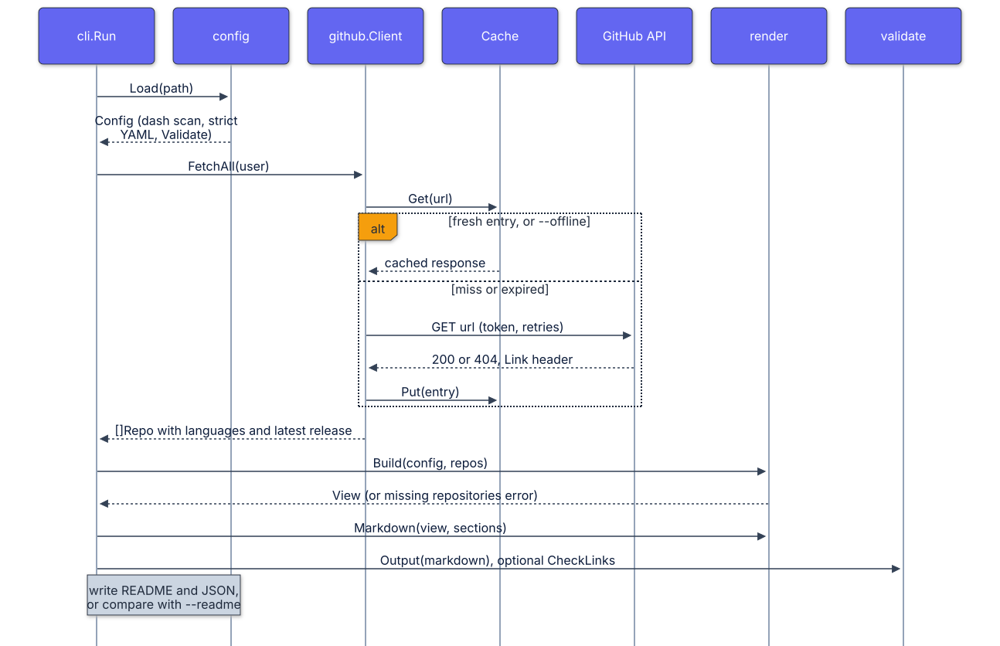

# Architecture

profile-forge is a single binary with one pipeline. Every command except
`init` and `version` runs the same steps; `generate` writes the result,
`check` compares it with a file on disk.

  

## Stages

### 1. Config (`internal/config`)

- The raw bytes are scanned for U+2014, U+2013, and their named, decimal,
  and hexadecimal HTML entities (case-insensitive) before YAML decoding, so the error points at a line and column in the file the user
  edits.
- `yaml.v3` decodes with `KnownFields(true)`.
- Defaults are applied (sections, top languages, path chart limits, stroke
  and text colors, legend color names).
- `Validate` collects every problem into one joined error.
- `Repos()` lists every referenced repository in a stable order; render uses
  it to check existence against the fetched list.

### 2. Fetch (`internal/github`)

- `ListRepos` requests `/users/{user}/repos?per_page=100&type=owner` and
  follows `Link: rel="next"` until it ends, with a hard limit of 50 pages.
  Private repositories are dropped even if a token would return them.
- `FetchAll` enriches every repository with `/languages` and
  `/releases/latest` through a pool of 8 workers. The first error cancels the
  remaining work.
- Requests send `Accept: application/vnd.github+json` and
  `X-GitHub-Api-Version: 2022-11-28`. 5xx responses and transport errors are
  retried twice with linear backoff. A 403 or 429 with
  `X-RateLimit-Remaining: 0` produces an error that tells the user to set a
  token.
- 200 and 404 responses are cached. A 404 is a meaningful answer for
  `/releases/latest` (no release), so caching it keeps offline runs complete.

### 3. Cache (`internal/github/cache.go`)

- One JSON file per URL, named by the first 16 bytes of the SHA-256 of the
  URL. The entry stores the URL, status, `Link` header, body, and fetch time.
- Reads verify the stored URL, so a hash collision is a miss rather than a
  wrong answer.
- Writes go to a temporary file in the cache directory and are renamed into
  place, so a crash never leaves a half-written entry.
- Online runs treat entries older than the TTL as misses. `--offline` accepts
  any entry and turns a miss into an error.

### 4. Render (`internal/render`)

- `Build` produces a `View`: header text, configured and computed badges,
  categories with resolved repositories, flagships, releases, the language
  summary, and the three mermaid sources.
- Repository descriptions pass through `config.ReplaceDashes`.
- Mermaid node ids are prefixed (`n_`, `r_`, `c_`) and sanitized to
  `[A-Za-z0-9_]`, which avoids keywords such as `end` and characters such as
  dots in repository names. Labels escape double quotes as `#quot;`.
- The template defines one named template per section. `Markdown` executes
  them in config order, drops empty sections, joins with horizontal rules,
  and adds a generated-file comment and the optional footer.

### 5. Validate (`internal/validate`)

- `Output` scans the final Markdown for dashes and runs the mermaid checks.
- `Mermaid` extracts fenced blocks (an unclosed fence is an error), then
  checks the header and, for flowcharts, balanced quotes and brackets outside
  quoted text, `classDef` syntax, `class` statements that reference defined
  classes and declared nodes, and reserved words used as ids. Pie charts must
  contain only a title and `"label" : number` lines.
- `CheckLinks` requests every image URL with bounded concurrency and reports
  every failure, not only the first.
- `Coverage` lists public repositories missing from the config.

## Determinism

The README contains no timestamps. Language rows are sorted by bytes, then by
name. Everything else follows config order, and releases are sorted by
repository name. Given the same cache, two runs are byte-identical; the CLI
tests assert this by comparing an online run with an offline run.

## Error handling

Errors are returned, wrapped with context, and printed once by `cli.Run`,
which maps them to exit code 1. Usage errors exit with 2. Warnings (for
uncategorized repositories) go to stderr and do not change the exit code.
