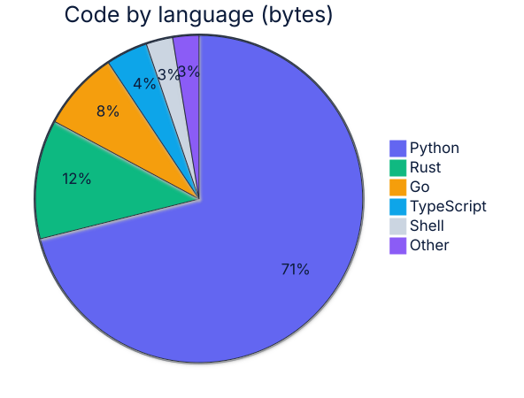

<!-- Generated by profile-forge. Edit the config file, not this file. -->

# Adeolu Ogunnoiki

### AI and Machine Learning Engineer

**I build AI agents and products that are rigorously tested for correctness and safety.**

My work covers the full stack of modern AI, from model internals and retrieval to agents and
evaluation. I use whichever language fits the problem best, including Python, Go, Rust and
TypeScript. Every project ships with passing CI, a versioned release, measured benchmarks and
recorded demos, and wherever an established library exists, results are checked against it.

[Homebrew tap](https://github.com/adeoluo/homebrew-tap) | [profile-forge (generates this page)](https://github.com/adeoluo/profile-forge)

---

## Stack

Languages and tools used in these repositories. Libraries marked reference are what my implementations are validated against, not what they are built on.

**Languages**

     

**AI and machine learning**

             

**Systems and data**

     

**Quality**

         

**Delivery**

     

---

## Find your path

What do you want to explore? Colors group projects by the stage of the stack they live in, and the same colors are used in every diagram on this page. Flagships are in bold.

  

**Legend**

| Color | Category | What it covers | Repos |
|---|---|---|---|
|  | Modeling and training | Model internals, training loops, tokenization, data preparation, and classical NLP models. | 9 |
|  | Retrieval and search | Approximate nearest neighbor search, hybrid and graph retrieval, and grounded generation. | 5 |
|  | Alignment and post-training | Reward modeling, RLHF, preference optimization, self-training, and prompt optimization. | 4 |
|  | Serving and reliability | The layer between models and users, covering compiled inference, safety, caching, failover, and structured output. | 3 |
|  | Agents | Tool-using agents, multi-agent orchestration, and language-model products built on them. | 7 |
|  | Evaluation and trust | Evaluation statistics, tracing, factuality, red-teaming, and reproducible provenance. | 6 |
|  | AI security | Attacks on and defenses for models, LLM applications, agents, and the model supply chain, mapped to OWASP LLM Top 10 2026 and MITRE ATLAS. | 8 |
|  | Ranking and applied ML | Learning to rank, ads and auctions, and anomaly detection on public benchmark data at full scale. | 3 |
|  | Systems and tooling | Storage engines, experiment orchestration, hyperparameter search, and developer tools. | 6 |

---

## How the projects connect

The projects compose into one pipeline: data is tokenized and deduplicated, models are trained and aligned, results are retrieved and served, agents act on them, and everything is evaluated, traced, and reproducible. Dotted arrows are cross-cutting relationships. Colors match the legend.

  

---

## Flagship projects

Each flagship pairs an implementation with independent, reproducible evidence that it is correct. Results that are not wins are reported as they are.

| Project | What it is | Validation and results |
|---|---|---|
| [agent-platform](https://github.com/adeoluo/agent-platform)  | An integrated AI platform composed from nine of these libraries | OpenAI and Anthropic failover, streamed agent steps, an MCP server, and per-tenant memory; a worker **killed mid-job resumes without re-running steps** (SIGKILL test in CI) |
| [transformer-from-scratch](https://github.com/adeoluo/transformer-from-scratch)  | A decoder-only transformer and a reverse-mode autodiff engine | Matches **PyTorch to < 1e-9**; **3.64 bits/char** on real text vs 4.30; a pre-registered 8-seed study whose induction hypothesis was **not supported** |
| [evaluation-harness](https://github.com/adeoluo/evaluation-harness)  | A model and agent evaluation framework | Statistics cross-checked against **SciPy to machine precision**: bootstrap CIs, McNemar, and Cohen's d |
| [ann-vector-search-library](https://github.com/adeoluo/ann-vector-search-library)  | An HNSW approximate nearest neighbor library with a Rust core | **Matches hnswlib's recall** on 100,000 SIFT vectors, and the default Rust core answers **1.2 to 1.5x faster** on ARM, where hnswlib runs without SIMD |
| [rlhf-reward-model](https://github.com/adeoluo/rlhf-reward-model)  | A reward model with PPO and DPO policy optimization | A head-to-head PPO vs DPO comparison on the same preference task, and a **reward over-optimization (Goodhart) study** |
| [constrained-generation-library](https://github.com/adeoluo/constrained-generation-library)  | A schema-constrained decoder built on compiled automata | **240 of 240** outputs validate against the `jsonschema` reference; the two agree on 2,008 cases |
| [llm-gateway](https://github.com/adeoluo/llm-gateway)  | A safety gateway for LLM APIs, with a Go reverse proxy | Retry and failover, **per-tenant isolation**, and injection and PII defenses; the Go proxy matches the Python rules on every parity case |
| [hybrid-rag](https://github.com/adeoluo/hybrid-rag)  | A hybrid retrieval system evaluated on the BEIR benchmark | Stemmed BM25 scores **0.687 nDCG@10 on SciFact**, above the published BEIR baseline of 0.665, and answers **about 200x faster than rank_bm25** on 171,000 documents |
| [react-agent](https://github.com/adeoluo/react-agent)  | A ReAct reasoning-and-acting agent | **Adversarial** tool-use robustness, recovery, and a benchmark against a single-shot baseline |
| [training-provenance](https://github.com/adeoluo/training-provenance)  | A content-addressed reproducibility and lineage system for ML | End-to-end reproduction, crash recovery, and an exhaustive **tamper-detection matrix** |
| [multi-agent-orchestrator](https://github.com/adeoluo/multi-agent-orchestrator)  | A planner, workers, and a critic over a shared blackboard | **Durable execution** with resume, and a single-agent vs orchestrator comparison |
| [corpus-dedup-library](https://github.com/adeoluo/corpus-dedup-library)  | Near-duplicate detection for training corpora, with a Rust core | Deduplicates **1.4 million C4 documents in 30 seconds**; exact mode reaches **precision 1.000** and runs **13.7x faster than datasketch** |
| [bpe-tokenizer-library](https://github.com/adeoluo/bpe-tokenizer-library)  | A byte-level BPE tokenizer with a Rust core that matches its Python reference token for token | Trains a **50,257-token vocabulary on 100 MB of C4 in 6.7 seconds** and encodes **faster than tiktoken** in batch (68.5 vs 52.4 MB/s) |
| [vectordb-go](https://github.com/adeoluo/vectordb-go)  | A persistent HNSW vector database server in Go (`brew install adeoluo/tap/vectordb`) | On **one million SIFT vectors**, NEON kernels answer **1.3 to 3.5x faster than hnswlib** at similar recall on ARM; checksummed write-ahead log and crash recovery |
| [llm-vuln-scanner](https://github.com/adeoluo/llm-vuln-scanner)  | A vulnerability scanner for LLM applications and agents, mapped to OWASP LLM Top 10 2026, OWASP Agentic Top 10 2026, and MITRE ATLAS | Scans **five current local models** (Qwen3.5 0.8B to 4B, Gemma 4 E2B, Granite 4.2 3B) with 540 attacks each, 42% to 50% succeeding; hardening the demo app cuts successful attacks **from 81 to 37 of 222**; compared with garak 0.17.1 on the same model |
| [prompt-injection-detector](https://github.com/adeoluo/prompt-injection-detector)  | A prompt-injection detector trained on 13 public datasets, with a Rust n-gram scorer | **AUROC 0.9996** and **99.5% of attacks caught at 1% FPR** on 91,089 held-out prompts in **27 microseconds** per prompt; the published protectai DeBERTa model catches 87.6% on the same split |
| [mcp-security-scanner](https://github.com/adeoluo/mcp-security-scanner)  | A static and live security scanner for Model Context Protocol servers, in Go | **Recall 1.00 at a 2% false positive rate** on 432 planted vulnerable servers, where Semgrep 1.184 finds 59% of command injection and none of the path traversal; the hard tier it misses is reported |
| [learning-to-rank](https://github.com/adeoluo/learning-to-rank)  | LambdaMART with a Rust histogram core, neural rankers, and unbiased learning to rank | **NDCG@10 0.503** over five folds of MSLR-WEB10K (1.2 million documents), against LightGBM 0.504 and XGBoost 0.506 with identical settings; 500 trees train in 68 s versus 82 s for XGBoost |

---

## Everything, by category

### Modeling and training 

Model internals, training loops, tokenization, data preparation, and classical NLP models.

- **[transformer-from-scratch](https://github.com/adeoluo/transformer-from-scratch)**: A reverse-mode automatic differentiation engine and a decoder-only transformer language model, built from scratch; gradients verified against finite differences and attention demonstrated on a copy task. Python
- [cnn-from-scratch](https://github.com/adeoluo/cnn-from-scratch): A convolutional neural network and its explicit backpropagation (conv2d, pooling, dense), built from scratch in Python; gradients verified against finite differences and translation invariance demonstrated against a linear baseline. Python
- [neural-word-embeddings](https://github.com/adeoluo/neural-word-embeddings): Skip-gram word embeddings with negative sampling from scratch: hand-derived gradients, a unigram negative-sampling table, and category-retrieval evaluation. Python
- **[bpe-tokenizer-library](https://github.com/adeoluo/bpe-tokenizer-library)**: A byte-level BPE tokenizer implementing the GPT-2 algorithm, with a Rust core (PyO3) used by default that matches its Python reference token for token; lossless for any input and faster than tiktoken in batch. Rust
- **[corpus-dedup-library](https://github.com/adeoluo/corpus-dedup-library)**: A corpus near-deduplication and quality-filtering library using MinHash and LSH, with a bit-exact Rust core used by default, a Python reference, and a JSONL CLI; deduplicates 1.4 million C4 documents in 30 seconds. Python
- [crf-sequence-labeler](https://github.com/adeoluo/crf-sequence-labeler): A linear-chain conditional random field for sequence labeling from scratch: Viterbi decoding, forward-backward training with log-likelihood gradients, and span-level evaluation. Python
- [dependency-parser](https://github.com/adeoluo/dependency-parser): An arc-standard transition-based dependency parser from scratch: a static oracle, an averaged structured perceptron policy, greedy decoding, and attachment-score evaluation. Python
- [statistical-translation](https://github.com/adeoluo/statistical-translation): Statistical machine translation alignment from scratch: IBM Model 1 and Model 2 word alignment trained by expectation-maximization, with alignment-error-rate evaluation. Python
- [topic-model-lda](https://github.com/adeoluo/topic-model-lda): Latent Dirichlet allocation from scratch: collapsed Gibbs sampling with a Rust sampler that reproduces the Python one exactly, and UMass topic-coherence evaluation; faster than gensim on C4. Python

### Retrieval and search 

Approximate nearest neighbor search, hybrid and graph retrieval, and grounded generation.

- **[ann-vector-search-library](https://github.com/adeoluo/ann-vector-search-library)**: An approximate nearest neighbor search library implementing HNSW graphs, with a Rust core used by default (SIMD f32, or f64 matching the Python reference exactly); matches hnswlib's recall on SIFT. Python
- **[hybrid-rag](https://github.com/adeoluo/hybrid-rag)**: Hybrid retrieval from scratch: stemmed BM25 and TF-IDF over inverted indexes, reciprocal-rank fusion and reranking, evaluated on BEIR; 0.687 nDCG@10 on SciFact. Python
- [graphrag](https://github.com/adeoluo/graphrag): GraphRAG from scratch: entity and relation extraction, knowledge-graph construction, and traversal-based multi-hop retrieval. Python
- [agentic-rag](https://github.com/adeoluo/agentic-rag): Agentic retrieval from scratch: query decomposition, a self-querying retriever-agent, and iterative multi-hop retrieve-reason-retrieve. Python
- [grounded-copilot](https://github.com/adeoluo/grounded-copilot): A retrieval-augmented copilot built from scratch: TF-IDF retrieval, inline citations, an abstention guardrail when retrieval is weak, and a sentence-level faithfulness check that verifies every claim traces to a cited source. Python

### Alignment and post-training 

Reward modeling, RLHF, preference optimization, self-training, and prompt optimization.

- **[rlhf-reward-model](https://github.com/adeoluo/rlhf-reward-model)**: Classical RLHF from scratch: a Bradley-Terry reward model with PPO, a DPO implementation with a head-to-head PPO versus DPO comparison, and an explicit reward over-optimization study. Python
- [preference-optimization](https://github.com/adeoluo/preference-optimization): Direct Preference Optimization from scratch: a behavior-cloned reference, a Bradley-Terry preference dataset, and an exact DPO gradient that aligns a policy to a hidden reward. Python
- [self-improvement-loop](https://github.com/adeoluo/self-improvement-loop): Recursive self-improvement by rejection-sampling self-training with a verifier (STaR-style) from scratch: generate, verify, filter, rationalize, and behavior-clone a policy on a fully checkable reasoning task. Python
- [prompt-optimizer](https://github.com/adeoluo/prompt-optimizer): Automated prompt optimization from scratch: instruction search and bootstrapped few-shot selection compiled against a metric, with a four-way ablation and an HTTP service. Python

### Serving and reliability 

The layer between models and users, covering compiled inference, safety, caching, failover, and structured output.

- **[llm-gateway](https://github.com/adeoluo/llm-gateway)**: A safety gateway for language-model APIs: prompt-injection defense, PII redaction, output-policy enforcement, and a semantic cache, plus a Go reverse proxy with the same rules, measured on an adversarial suite. Python
- **[constrained-generation-library](https://github.com/adeoluo/constrained-generation-library)**: A structured-generation library built from scratch in Python: compiles a JSON Schema into a finite automaton and masks a model's tokens so output is schema-valid by construction (100% valid JSON across any model versus 0% unconstrained). Python
- [ml-graph-compiler](https://github.com/adeoluo/ml-graph-compiler): Deep learning graph compiler: ONNX import, SSA IR, fusion and layout passes, static memory planning, C code generation with clang and NEON, and MLIR export Python

### Agents 

Tool-using agents, multi-agent orchestration, and language-model products built on them.

- **[react-agent](https://github.com/adeoluo/react-agent)**: A ReAct reasoning-and-acting agent built from scratch: tool use, a transparent control loop, and full step tracing. Python
- **[multi-agent-orchestrator](https://github.com/adeoluo/multi-agent-orchestrator)**: A multi-agent orchestrator from scratch: a planner decomposes a task, workers execute subtasks, and a critic verifies, over a shared blackboard. Python
- **[agent-platform](https://github.com/adeoluo/agent-platform)**: An integrated AI platform composed from nine of these libraries: an authenticated multi-tenant API, OpenAI and Anthropic failover, streamed agent steps, an MCP server, per-tenant memory, durable multi-agent jobs with crash recovery, tracing, and evaluation. Python
- [agent-memory](https://github.com/adeoluo/agent-memory): Long-term memory for AI agents: episodic, semantic, and procedural memory in SQLite with hybrid retrieval, fact versioning, consolidation, and an MCP server. Python
- [nl-sql-analyst](https://github.com/adeoluo/nl-sql-analyst): A natural-language-to-SQL analyst powered by a plugged-in language model, with read-only guardrails and result verification; validated SQL runs against a real SQLite database and is evaluated for answer accuracy and guardrail coverage. Python
- [ai-code-reviewer](https://github.com/adeoluo/ai-code-reviewer): An automated code reviewer powered by a plugged-in language model (Claude in production, an offline provider in CI), evaluated on a labeled benchmark of bug-introducing diffs for real bug-catching precision and recall. Python
- [agent-sandbox](https://github.com/adeoluo/agent-sandbox): A policy-based sandbox for running AI agent tool calls with declarative rules, resource limits, and a tamper-evident audit log. Rust

### Evaluation and trust 

Evaluation statistics, tracing, factuality, red-teaming, and reproducible provenance.

- **[evaluation-harness](https://github.com/adeoluo/evaluation-harness)**: An evaluation and benchmarking framework for language models and agents, built from scratch: pluggable tasks and graders, bootstrap confidence intervals, significance testing, and contamination checks. Python
- [llm-observability](https://github.com/adeoluo/llm-observability): An LLM observability stack: a Python tracing library, a collector with a JSON API, and a TypeScript dashboard for traces, latency, tokens, and cost. Python
- **[training-provenance](https://github.com/adeoluo/training-provenance)**: Content-addressed provenance tracking for machine learning pipelines: a deduplicating artifact store, a content-addressed lineage DAG, and bit-for-bit reproducibility and integrity verification. Python
- [factuality-auditor](https://github.com/adeoluo/factuality-auditor): A hallucination and factuality auditor from scratch: claim extraction, knowledge-base verification, and calibrated confidence with honest abstention. Python
- [red-teaming](https://github.com/adeoluo/red-teaming): An automated red-teaming engine from scratch: an evolutionary search for guardrail-evading prompts, attack-success measurement, and a hardened defense, over fully fictional restricted terms. Python
- [llm-eval-action](https://github.com/adeoluo/llm-eval-action): A GitHub Action that gates pull requests on statistically tested LLM evaluation regressions. TypeScript

### AI security 

Attacks on and defenses for models, LLM applications, agents, and the model supply chain, mapped to OWASP LLM Top 10 2026 and MITRE ATLAS.

- **[llm-vuln-scanner](https://github.com/adeoluo/llm-vuln-scanner)**: Vulnerability scanner for LLM applications and agents: prompt injection, sensitive information disclosure, excessive agency, output handling and jailbreak probes with canary detectors, mapped to the OWASP Top 10 for LLM Applications 2026, the OWASP Agentic Top 10 2026 and MITRE ATLAS v2026.10, with SARIF reports and a GitHub Action Python
- **[prompt-injection-detector](https://github.com/adeoluo/prompt-injection-detector)**: Prompt-injection and jailbreak classifier with a Rust n-gram core, a fine-tuned small transformer and a leakage-safe benchmark against a published detector Python
- **[mcp-security-scanner](https://github.com/adeoluo/mcp-security-scanner)**: Go scanner for Model Context Protocol servers: taint analysis of server source, tool poisoning checks, live probing, rug pull pinning and SARIF output for CI Go
- [llm-dlp-guard](https://github.com/adeoluo/llm-dlp-guard): Data loss prevention for LLM traffic: detects and reversibly redacts PII, secrets and credentials in prompts, responses and token streams, with a Rust core Python
- [model-supply-chain-scanner](https://github.com/adeoluo/model-supply-chain-scanner): Static scanner for ML model files (pickle, PyTorch, joblib, NumPy, Keras, SavedModel, ONNX, GGUF, safetensors) that finds code execution and malformed structure before loading, with a Rust core, SARIF output and Python bindings Rust
- [adversarial-robustness-lab](https://github.com/adeoluo/adversarial-robustness-lab): Evasion attacks (FGSM, PGD, C&W, APGD, Square, AutoAttack-style ensemble), adversarial training (PGD-AT, TRADES, FGSM-RS) and randomized smoothing certification on the full CIFAR-10 test set, checked against torchattacks 3.5.1 and mapped to MITRE ATLAS v2026.10 Python
- [privacy-attacks-lab](https://github.com/adeoluo/privacy-attacks-lab): Membership inference attacks (LiRA, shadow models), DP-SGD with RDP and PRV accountants checked against Opacus, and canary extraction from a small language model Python
- [backdoor-defense-lab](https://github.com/adeoluo/backdoor-defense-lab): Backdoor attacks (BadNets, Blend, WaNet, clean label, rare token) and defenses (spectral signatures, activation clustering, STRIP, Neural Cleanse, fine pruning, ONION) measured on CIFAR-10, GTSRB and SST-2 Python

### Ranking and applied ML 

Learning to rank, ads and auctions, and anomaly detection on public benchmark data at full scale.

- **[learning-to-rank](https://github.com/adeoluo/learning-to-rank)**: LambdaMART with a Rust histogram core, neural rankers, click models and unbiased learning to rank, compared with LightGBM and XGBoost on MSLR-WEB10K and Istella-S Python
- [ad-auction-lab](https://github.com/adeoluo/ad-auction-lab): Ad auctions (GSP, VCG, first price), bid shading, budget pacing, hashed CTR models on Criteo and off-policy evaluation on the Open Bandit Dataset, with a Rust core Python
- [log-anomaly-detection](https://github.com/adeoluo/log-anomaly-detection): Log parsing and anomaly detection on Loghub: a Rust Drain parser, six detectors from PCA to DeepLog and a transformer, streaming alerts and change-point regression detection. Python

### Systems and tooling 

Storage engines, experiment orchestration, hyperparameter search, and developer tools.

- **[vectordb-go](https://github.com/adeoluo/vectordb-go)**: A concurrent, persistent HNSW vector database server in Go: a checksummed write-ahead log, snapshot and replay crash recovery, an HTTP API, and benchmarks against hnswlib and FAISS. Go
- [mcp-ml-tools](https://github.com/adeoluo/mcp-ml-tools): A Model Context Protocol server with machine learning engineering tools: BPE token counting and cost estimates, BM25 search, paired bootstrap and McNemar evaluation comparison, JSON Schema validation, and prompt-injection and PII scanning. TypeScript
- [sweep-orchestrator](https://github.com/adeoluo/sweep-orchestrator): A hyperparameter sweep orchestrator from scratch: successive halving and Hyperband, parallel early stopping, multi-objective Pareto optimization, and hyperparameter importance. Python
- [hyperparameter-optimizer](https://github.com/adeoluo/hyperparameter-optimizer): Black-box hyperparameter optimization from scratch: random and quasi-random search, a Tree-structured Parzen Estimator, and Gaussian-process Bayesian optimization with Expected Improvement. Python
- [profile-forge](https://github.com/adeoluo/profile-forge): A Go CLI that generates a GitHub profile README and portfolio JSON from live repository metadata and a small YAML config. Go
- [homebrew-tap](https://github.com/adeoluo/homebrew-tap): Homebrew formulas for vectordb, agent-sandbox, corpus-dedup, and profile-forge. Ruby

---

## Languages

Bytes of code per language, summed across my public repositories with the GitHub languages API. Forks are excluded.

| Language | Bytes | Share | Repos |
|---|--:|--:|--:|
| Python | 5.7 MiB | 71.1% | 47 |
| Rust | 958.0 KiB | 11.8% | 13 |
| Go | 638.0 KiB | 7.8% | 4 |
| TypeScript | 335.7 KiB | 4.1% | 4 |
| Shell | 214.4 KiB | 2.6% | 50 |
| Other | 210.6 KiB | 2.6% |  |

  

Counted 8.0 MiB across the 51 repositories that contain code.

---

## Releases

Repositories with a tagged release. Badges link to the release page.

| Project | Latest release | Language |
|---|---|---|
| [ad-auction-lab](https://github.com/adeoluo/ad-auction-lab) |  | Python |
| [adversarial-robustness-lab](https://github.com/adeoluo/adversarial-robustness-lab) |  | Python |
| [agent-memory](https://github.com/adeoluo/agent-memory) |  | Python |
| [agent-platform](https://github.com/adeoluo/agent-platform) |  | Python |
| [agent-sandbox](https://github.com/adeoluo/agent-sandbox) |  | Rust |
| [agentic-rag](https://github.com/adeoluo/agentic-rag) |  | Python |
| [ai-code-reviewer](https://github.com/adeoluo/ai-code-reviewer) |  | Python |
| [ann-vector-search-library](https://github.com/adeoluo/ann-vector-search-library) |  | Python |
| [backdoor-defense-lab](https://github.com/adeoluo/backdoor-defense-lab) |  | Python |
| [bpe-tokenizer-library](https://github.com/adeoluo/bpe-tokenizer-library) |  | Rust |
| [cnn-from-scratch](https://github.com/adeoluo/cnn-from-scratch) |  | Python |
| [constrained-generation-library](https://github.com/adeoluo/constrained-generation-library) |  | Python |
| [corpus-dedup-library](https://github.com/adeoluo/corpus-dedup-library) |  | Python |
| [crf-sequence-labeler](https://github.com/adeoluo/crf-sequence-labeler) |  | Python |
| [dependency-parser](https://github.com/adeoluo/dependency-parser) |  | Python |
| [evaluation-harness](https://github.com/adeoluo/evaluation-harness) |  | Python |
| [factuality-auditor](https://github.com/adeoluo/factuality-auditor) |  | Python |
| [graphrag](https://github.com/adeoluo/graphrag) |  | Python |
| [grounded-copilot](https://github.com/adeoluo/grounded-copilot) |  | Python |
| [hybrid-rag](https://github.com/adeoluo/hybrid-rag) |  | Python |
| [hyperparameter-optimizer](https://github.com/adeoluo/hyperparameter-optimizer) |  | Python |
| [learning-to-rank](https://github.com/adeoluo/learning-to-rank) |  | Python |
| [llm-dlp-guard](https://github.com/adeoluo/llm-dlp-guard) |  | Python |
| [llm-eval-action](https://github.com/adeoluo/llm-eval-action) |  | TypeScript |
| [llm-gateway](https://github.com/adeoluo/llm-gateway) |  | Python |
| [llm-observability](https://github.com/adeoluo/llm-observability) |  | Python |
| [llm-vuln-scanner](https://github.com/adeoluo/llm-vuln-scanner) |  | Python |
| [log-anomaly-detection](https://github.com/adeoluo/log-anomaly-detection) |  | Python |
| [mcp-ml-tools](https://github.com/adeoluo/mcp-ml-tools) |  | TypeScript |
| [mcp-security-scanner](https://github.com/adeoluo/mcp-security-scanner) |  | Go |
| [ml-graph-compiler](https://github.com/adeoluo/ml-graph-compiler) |  | Python |
| [model-supply-chain-scanner](https://github.com/adeoluo/model-supply-chain-scanner) |  | Rust |
| [multi-agent-orchestrator](https://github.com/adeoluo/multi-agent-orchestrator) |  | Python |
| [neural-word-embeddings](https://github.com/adeoluo/neural-word-embeddings) |  | Python |
| [nl-sql-analyst](https://github.com/adeoluo/nl-sql-analyst) |  | Python |
| [preference-optimization](https://github.com/adeoluo/preference-optimization) |  | Python |
| [privacy-attacks-lab](https://github.com/adeoluo/privacy-attacks-lab) |  | Python |
| [profile-forge](https://github.com/adeoluo/profile-forge) |  | Go |
| [prompt-injection-detector](https://github.com/adeoluo/prompt-injection-detector) |  | Python |
| [prompt-optimizer](https://github.com/adeoluo/prompt-optimizer) |  | Python |
| [react-agent](https://github.com/adeoluo/react-agent) |  | Python |
| [red-teaming](https://github.com/adeoluo/red-teaming) |  | Python |
| [rlhf-reward-model](https://github.com/adeoluo/rlhf-reward-model) |  | Python |
| [self-improvement-loop](https://github.com/adeoluo/self-improvement-loop) |  | Python |
| [statistical-translation](https://github.com/adeoluo/statistical-translation) |  | Python |
| [sweep-orchestrator](https://github.com/adeoluo/sweep-orchestrator) |  | Python |
| [topic-model-lda](https://github.com/adeoluo/topic-model-lda) |  | Python |
| [training-provenance](https://github.com/adeoluo/training-provenance) |  | Python |
| [transformer-from-scratch](https://github.com/adeoluo/transformer-from-scratch) |  | Python |
| [vectordb-go](https://github.com/adeoluo/vectordb-go) |  | Go |

---

Generated by profile-forge from live repository metadata.

