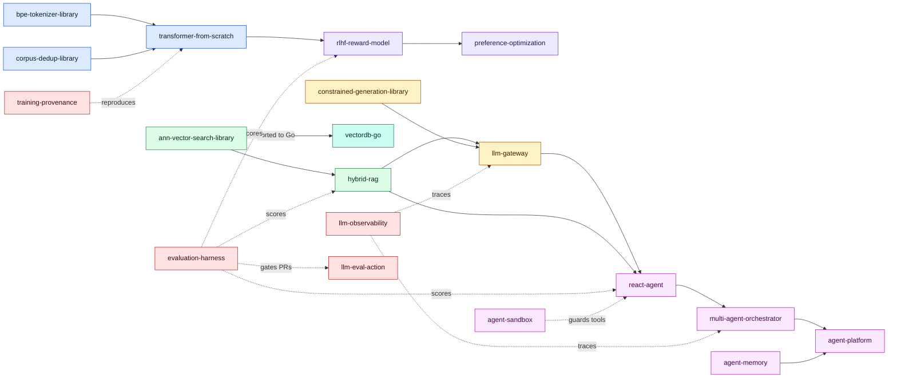
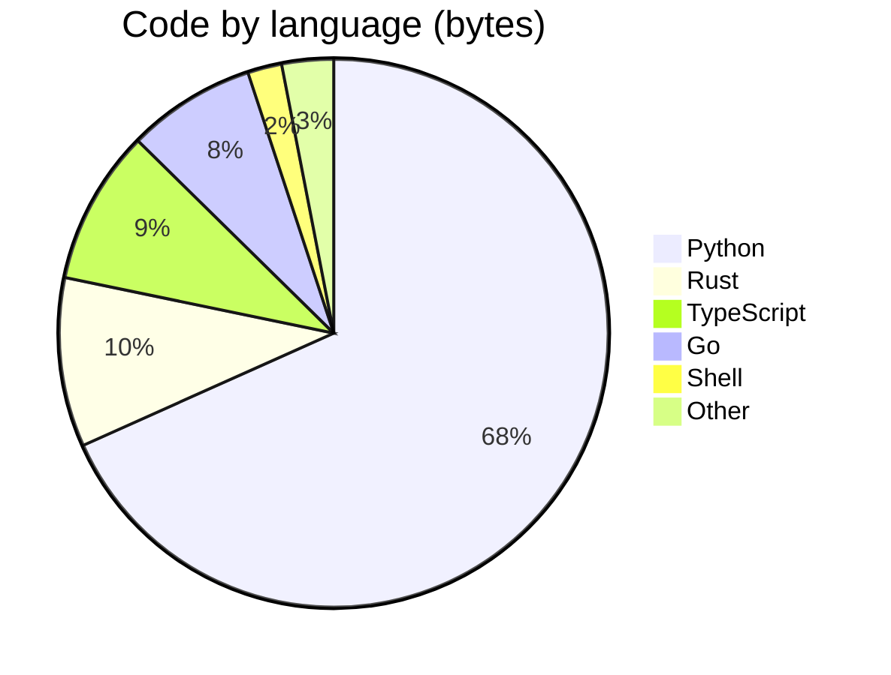

<!-- Generated by profile-forge. Edit the config file, not this file. -->

# Adeolu Ogunnoiki

### AI and Machine Learning Engineer

**I build AI and machine learning systems from the algorithm up, and validate them against established libraries.**

Transformers and autodiff, vector search, alignment and post-training, retrieval, agents, evaluation,
and the infrastructure around them, written in Python, Go, Rust, and TypeScript, choosing the language
that fits each problem. Projects ship with green CI, versioned releases, measured benchmarks, and
recorded demos, and are checked against widely used reference libraries where it matters.

[Homebrew tap](https://github.com/adeoluo/homebrew-tap) | [profile-forge (generates this page)](https://github.com/adeoluo/profile-forge)

---

## Stack

Languages and tools used in these repositories. Libraries marked reference are what my implementations are validated against, not what they are built on.

**Languages**

     

**AI and machine learning**

       

**Systems and data**

     

**Quality**

         

**Delivery**

     

---

## Find your path

Pick what you want to see. Colors group projects by the stage of the stack they live in, and the same colors are used in every diagram on this page. Flagships are in bold.

```mermaid
%%{init: {"flowchart": {"wrappingWidth": 320}}}%%
flowchart TD
  n_root(["What do you want to explore?"])
  n_root --> n_model["<u>Modeling and training</u><br/><b>transformer-from-scratch</b><br/>cnn-from-scratch<br/>neural-word-embeddings<br/>bpe-tokenizer-library<br/>corpus-dedup-library<br/>crf-sequence-labeler<br/>dependency-parser<br/>statistical-translation<br/>topic-model-lda"]
  n_root --> n_retr["<u>Retrieval and search</u><br/><b>ann-vector-search-library</b><br/><b>hybrid-rag</b><br/>graphrag<br/>agentic-rag<br/>grounded-copilot"]
  n_root --> n_align["<u>Alignment and post-training</u><br/><b>rlhf-reward-model</b><br/>preference-optimization<br/>self-improvement-loop<br/>prompt-optimizer"]
  n_root --> n_serve["<u>Serving and reliability</u><br/><b>llm-gateway</b><br/><b>constrained-generation-library</b>"]
  n_root --> n_agent["<u>Agents</u><br/><b>react-agent</b><br/><b>multi-agent-orchestrator</b><br/><b>agent-platform</b><br/>agent-memory<br/>nl-sql-analyst<br/>ai-code-reviewer<br/>agent-sandbox"]
  n_root --> n_trust["<u>Evaluation and trust</u><br/><b>evaluation-harness</b><br/><b>training-provenance</b><br/>llm-observability<br/>factuality-auditor<br/>red-teaming<br/>llm-eval-action"]
  n_root --> n_sys["<u>Systems and tooling</u><br/><b>vectordb-go</b><br/>mcp-ml-tools<br/>sweep-orchestrator<br/>hyperparameter-optimizer<br/>profile-forge<br/>homebrew-tap"]

  classDef c_root fill:#1f2937,stroke:#111827,color:#f9fafb;
  classDef c_model fill:#dbeafe,stroke:#1d4ed8,color:#0b1b3a;
  classDef c_retr fill:#dcfce7,stroke:#15803d,color:#052e16;
  classDef c_align fill:#ede9fe,stroke:#6d28d9,color:#1e1b4b;
  classDef c_serve fill:#fef3c7,stroke:#b45309,color:#451a03;
  classDef c_agent fill:#fae8ff,stroke:#a21caf,color:#4a044e;
  classDef c_trust fill:#fee2e2,stroke:#b91c1c,color:#450a0a;
  classDef c_sys fill:#ccfbf1,stroke:#0f766e,color:#042f2e;

  class n_root c_root;
  class n_model c_model;
  class n_retr c_retr;
  class n_align c_align;
  class n_serve c_serve;
  class n_agent c_agent;
  class n_trust c_trust;
  class n_sys c_sys;
```

**Legend**

| Color | Category | What it covers | Repos |
|---|---|---|---|
|  | Modeling and training | Model internals, training loops, tokenization, data preparation, and classical NLP models. | 9 |
|  | Retrieval and search | Approximate nearest neighbor search, hybrid and graph retrieval, and grounded generation. | 5 |
|  | Alignment and post-training | Reward modeling, RLHF, preference optimization, self-training, and prompt optimization. | 4 |
|  | Serving and reliability | The layer between models and users, covering safety, caching, failover, and structured output. | 2 |
|  | Agents | Tool-using agents, multi-agent orchestration, and language-model products built on them. | 7 |
|  | Evaluation and trust | Evaluation statistics, tracing, factuality, red-teaming, and reproducible provenance. | 6 |
|  | Systems and tooling | Storage engines, experiment orchestration, hyperparameter search, and developer tools. | 6 |

---

## How the projects connect

The flagships compose into one pipeline: data is tokenized and deduplicated, models are trained and aligned, results are retrieved and served, agents act on them, and everything is evaluated, traced, and reproducible. Dotted arrows are cross-cutting relationships. Colors match the legend.

---

## Flagship projects

Each flagship pairs an implementation with independent, reproducible evidence that it is correct. Results that are not wins are reported as they are.

| Project | What it is | Validation and results |
|---|---|---|
| [agent-platform](https://github.com/adeoluo/agent-platform)  | An integrated AI platform composed from nine of these libraries | OpenAI and Anthropic failover, streamed agent steps, an MCP server, and per-tenant memory; a worker **killed mid-job resumes without re-running steps** (SIGKILL test in CI) |
| [transformer-from-scratch](https://github.com/adeoluo/transformer-from-scratch)  | A decoder-only transformer and a reverse-mode autodiff engine | Matches **PyTorch to < 1e-9**; **3.64 bits/char** on real text vs 4.30; a pre-registered 8-seed study whose induction hypothesis was **not supported** |
| [evaluation-harness](https://github.com/adeoluo/evaluation-harness)  | A model and agent evaluation framework | Statistics cross-checked against **SciPy to machine precision**: bootstrap CIs, McNemar, and Cohen's d |
| [ann-vector-search-library](https://github.com/adeoluo/ann-vector-search-library)  | An HNSW approximate nearest neighbor library with a Rust core | **Matches hnswlib's recall** at matched parameters; the Rust core reproduces the Python index exactly and is **14 to 22x faster** |
| [rlhf-reward-model](https://github.com/adeoluo/rlhf-reward-model)  | A reward model with PPO and DPO policy optimization | A head-to-head PPO vs DPO comparison on the same preference task, and a **reward over-optimization (Goodhart) study** |
| [constrained-generation-library](https://github.com/adeoluo/constrained-generation-library)  | A schema-constrained decoder built on compiled automata | **240 of 240** outputs validate against the `jsonschema` reference; the two agree on 2,008 cases |
| [llm-gateway](https://github.com/adeoluo/llm-gateway)  | A safety gateway for LLM APIs, with a Go reverse proxy | Retry and failover, **per-tenant isolation**, and injection and PII defenses; the Go proxy matches the Python rules on every parity case |
| [hybrid-rag](https://github.com/adeoluo/hybrid-rag)  | A hybrid retrieval system with a neural dense retriever | A full evaluation suite; the dense retriever ties on recall but ranks below strong lexical baselines at this scale |
| [react-agent](https://github.com/adeoluo/react-agent)  | A ReAct reasoning-and-acting agent | **Adversarial** tool-use robustness, recovery, and a benchmark against a single-shot baseline |
| [training-provenance](https://github.com/adeoluo/training-provenance)  | A content-addressed reproducibility and lineage system for ML | End-to-end reproduction, crash recovery, and an exhaustive **tamper-detection matrix** |
| [multi-agent-orchestrator](https://github.com/adeoluo/multi-agent-orchestrator)  | A planner, workers, and a critic over a shared blackboard | **Durable execution** with resume, and a single-agent vs orchestrator comparison |
| [vectordb-go](https://github.com/adeoluo/vectordb-go)  | A persistent HNSW vector database server in Go (`brew install adeoluo/tap/vectordb`) | A checksummed write-ahead log, snapshot and replay crash recovery, and benchmarks against hnswlib and FAISS |

---

## Everything, by category

### Modeling and training 

Model internals, training loops, tokenization, data preparation, and classical NLP models.

- **[transformer-from-scratch](https://github.com/adeoluo/transformer-from-scratch)**: A reverse-mode automatic differentiation engine and a decoder-only transformer language model, built from scratch; gradients verified against finite differences and attention demonstrated on a copy task. Python
- [cnn-from-scratch](https://github.com/adeoluo/cnn-from-scratch): A convolutional neural network and its explicit backpropagation (conv2d, pooling, dense), built from scratch in Python; gradients verified against finite differences and translation invariance demonstrated against a linear baseline. Python
- [neural-word-embeddings](https://github.com/adeoluo/neural-word-embeddings): Skip-gram word embeddings with negative sampling from scratch: hand-derived gradients, a unigram negative-sampling table, and category-retrieval evaluation. Python
- [bpe-tokenizer-library](https://github.com/adeoluo/bpe-tokenizer-library): A byte-level BPE tokenizer implementing the GPT-2 algorithm, with a reference Python implementation and an optional Rust core (PyO3) that produces identical token ids; lossless for any input. Rust
- [corpus-dedup-library](https://github.com/adeoluo/corpus-dedup-library): A corpus near-deduplication and quality-filtering library using MinHash and LSH, with a Python reference, a bit-exact Rust core, and a JSONL CLI; perfect precision and recall on a labeled corpus while comparing a tiny fraction of document pairs. Python
- [crf-sequence-labeler](https://github.com/adeoluo/crf-sequence-labeler): A linear-chain conditional random field for sequence labeling from scratch: Viterbi decoding, forward-backward training with log-likelihood gradients, and span-level evaluation. Python
- [dependency-parser](https://github.com/adeoluo/dependency-parser): An arc-standard transition-based dependency parser from scratch: a static oracle, an averaged structured perceptron policy, greedy decoding, and attachment-score evaluation. Python
- [statistical-translation](https://github.com/adeoluo/statistical-translation): Statistical machine translation alignment from scratch: IBM Model 1 and Model 2 word alignment trained by expectation-maximization, with alignment-error-rate evaluation. Python
- [topic-model-lda](https://github.com/adeoluo/topic-model-lda): Latent Dirichlet allocation from scratch: collapsed Gibbs sampling for topic discovery with UMass topic-coherence evaluation. Python

### Retrieval and search 

Approximate nearest neighbor search, hybrid and graph retrieval, and grounded generation.

- **[ann-vector-search-library](https://github.com/adeoluo/ann-vector-search-library)**: An approximate nearest neighbor search library implementing HNSW graphs, with a Python reference and an optional Rust core that reproduces it exactly; recall and distance-computation cost measured against exact search and hnswlib. Python
- **[hybrid-rag](https://github.com/adeoluo/hybrid-rag)**: Hybrid retrieval from scratch: BM25 and a trained TF-IDF dense retriever, reciprocal-rank fusion, a reranker, and a retrieval evaluation suite. Python
- [graphrag](https://github.com/adeoluo/graphrag): GraphRAG from scratch: entity and relation extraction, knowledge-graph construction, and traversal-based multi-hop retrieval. Python
- [agentic-rag](https://github.com/adeoluo/agentic-rag): Agentic retrieval from scratch: query decomposition, a self-querying retriever-agent, and iterative multi-hop retrieve-reason-retrieve. Python
- [grounded-copilot](https://github.com/adeoluo/grounded-copilot): A retrieval-augmented copilot built from scratch: TF-IDF retrieval, inline citations, an abstention guardrail when retrieval is weak, and a sentence-level faithfulness check that verifies every claim traces to a cited source. Python

### Alignment and post-training 

Reward modeling, RLHF, preference optimization, self-training, and prompt optimization.

- **[rlhf-reward-model](https://github.com/adeoluo/rlhf-reward-model)**: Classical RLHF from scratch: a Bradley-Terry reward model with PPO, a DPO implementation with a head-to-head PPO versus DPO comparison, and an explicit reward over-optimization study. Python
- [preference-optimization](https://github.com/adeoluo/preference-optimization): Direct Preference Optimization from scratch: a behavior-cloned reference, a Bradley-Terry preference dataset, and an exact DPO gradient that aligns a policy to a hidden reward. Python
- [self-improvement-loop](https://github.com/adeoluo/self-improvement-loop): Recursive self-improvement by rejection-sampling self-training with a verifier (STaR-style) from scratch: generate, verify, filter, rationalize, and behavior-clone a policy on a fully checkable reasoning task. Python
- [prompt-optimizer](https://github.com/adeoluo/prompt-optimizer): Automated prompt optimization from scratch: instruction search and bootstrapped few-shot selection compiled against a metric, with a four-way ablation and an HTTP service. Python

### Serving and reliability 

The layer between models and users, covering safety, caching, failover, and structured output.

- **[llm-gateway](https://github.com/adeoluo/llm-gateway)**: A safety gateway for language-model APIs: prompt-injection defense, PII redaction, output-policy enforcement, and a semantic cache, plus a Go reverse proxy with the same rules, measured on an adversarial suite. Python
- **[constrained-generation-library](https://github.com/adeoluo/constrained-generation-library)**: A structured-generation library built from scratch in Python: compiles a JSON Schema into a finite automaton and masks a model's tokens so output is schema-valid by construction (100% valid JSON across any model versus 0% unconstrained). Python

### Agents 

Tool-using agents, multi-agent orchestration, and language-model products built on them.

- **[react-agent](https://github.com/adeoluo/react-agent)**: A ReAct reasoning-and-acting agent built from scratch: tool use, a transparent control loop, and full step tracing. Python
- **[multi-agent-orchestrator](https://github.com/adeoluo/multi-agent-orchestrator)**: A multi-agent orchestrator from scratch: a planner decomposes a task, workers execute subtasks, and a critic verifies, over a shared blackboard. Python
- **[agent-platform](https://github.com/adeoluo/agent-platform)**: An integrated AI platform composed from nine of these libraries: an authenticated multi-tenant API, OpenAI and Anthropic failover, streamed agent steps, an MCP server, per-tenant memory, durable multi-agent jobs with crash recovery, tracing, and evaluation. Python
- [agent-memory](https://github.com/adeoluo/agent-memory): Long-term memory for AI agents: episodic, semantic, and procedural memory in SQLite with hybrid retrieval, fact versioning, consolidation, and an MCP server. Python
- [nl-sql-analyst](https://github.com/adeoluo/nl-sql-analyst): A natural-language-to-SQL analyst powered by a plugged-in language model, with read-only guardrails and result verification; validated SQL runs against a real SQLite database and is evaluated for answer accuracy and guardrail coverage. Python
- [ai-code-reviewer](https://github.com/adeoluo/ai-code-reviewer): An automated code reviewer powered by a plugged-in language model (Claude in production, an offline provider in CI), evaluated on a labeled benchmark of bug-introducing diffs for real bug-catching precision and recall. Python
- [agent-sandbox](https://github.com/adeoluo/agent-sandbox): A policy-based sandbox for running AI agent tool calls with declarative rules, resource limits, and a tamper-evident audit log. Rust

### Evaluation and trust 

Evaluation statistics, tracing, factuality, red-teaming, and reproducible provenance.

- **[evaluation-harness](https://github.com/adeoluo/evaluation-harness)**: An evaluation and benchmarking framework for language models and agents, built from scratch: pluggable tasks and graders, bootstrap confidence intervals, significance testing, and contamination checks. Python
- [llm-observability](https://github.com/adeoluo/llm-observability): An LLM observability stack: a Python tracing library, a collector with a JSON API, and a TypeScript dashboard for traces, latency, tokens, and cost. Python
- **[training-provenance](https://github.com/adeoluo/training-provenance)**: Content-addressed provenance tracking for machine learning pipelines: a deduplicating artifact store, a content-addressed lineage DAG, and bit-for-bit reproducibility and integrity verification. Python
- [factuality-auditor](https://github.com/adeoluo/factuality-auditor): A hallucination and factuality auditor from scratch: claim extraction, knowledge-base verification, and calibrated confidence with honest abstention. Python
- [red-teaming](https://github.com/adeoluo/red-teaming): An automated red-teaming engine from scratch: an evolutionary search for guardrail-evading prompts, attack-success measurement, and a hardened defense, over fully fictional restricted terms. Python
- [llm-eval-action](https://github.com/adeoluo/llm-eval-action): A GitHub Action that gates pull requests on statistically tested LLM evaluation regressions. TypeScript

### Systems and tooling 

Storage engines, experiment orchestration, hyperparameter search, and developer tools.

- **[vectordb-go](https://github.com/adeoluo/vectordb-go)**: A concurrent, persistent HNSW vector database server in Go: a checksummed write-ahead log, snapshot and replay crash recovery, an HTTP API, and benchmarks against hnswlib and FAISS. Go
- [mcp-ml-tools](https://github.com/adeoluo/mcp-ml-tools): A Model Context Protocol server with machine learning engineering tools: BPE token counting and cost estimates, BM25 search, paired bootstrap and McNemar evaluation comparison, JSON Schema validation, and prompt-injection and PII scanning. TypeScript
- [sweep-orchestrator](https://github.com/adeoluo/sweep-orchestrator): A hyperparameter sweep orchestrator from scratch: successive halving and Hyperband, parallel early stopping, multi-objective Pareto optimization, and hyperparameter importance. Python
- [hyperparameter-optimizer](https://github.com/adeoluo/hyperparameter-optimizer): Black-box hyperparameter optimization from scratch: random and quasi-random search, a Tree-structured Parzen Estimator, and Gaussian-process Bayesian optimization with Expected Improvement. Python
- [profile-forge](https://github.com/adeoluo/profile-forge): A Go CLI that generates a GitHub profile README and portfolio JSON from live repository metadata and a small YAML config. Go
- [homebrew-tap](https://github.com/adeoluo/homebrew-tap): Homebrew formulas for vectordb, agent-sandbox, corpus-dedup, and profile-forge. Ruby

---

## Languages

Bytes of code per language, summed across my public repositories with the GitHub languages API. Forks are excluded.

| Language | Bytes | Share | Repos |
|---|--:|--:|--:|
| Python | 2.4 MiB | 68.3% | 35 |
| Rust | 365.3 KiB | 10.0% | 4 |
| TypeScript | 334.4 KiB | 9.1% | 4 |
| Go | 277.5 KiB | 7.6% | 3 |
| Shell | 73.7 KiB | 2.0% | 20 |
| Other | 111.6 KiB | 3.0% |  |

Counted 3.6 MiB across 39 repositories.

---

## Releases

Repositories with a tagged release. Badges link to the release page.

| Project | Latest release | Language |
|---|---|---|
| [agent-memory](https://github.com/adeoluo/agent-memory) |  | Python |
| [agent-platform](https://github.com/adeoluo/agent-platform) |  | Python |
| [agent-sandbox](https://github.com/adeoluo/agent-sandbox) |  | Rust |
| [ann-vector-search-library](https://github.com/adeoluo/ann-vector-search-library) |  | Python |
| [bpe-tokenizer-library](https://github.com/adeoluo/bpe-tokenizer-library) |  | Rust |
| [constrained-generation-library](https://github.com/adeoluo/constrained-generation-library) |  | Python |
| [corpus-dedup-library](https://github.com/adeoluo/corpus-dedup-library) |  | Python |
| [evaluation-harness](https://github.com/adeoluo/evaluation-harness) |  | Python |
| [hybrid-rag](https://github.com/adeoluo/hybrid-rag) |  | Python |
| [llm-eval-action](https://github.com/adeoluo/llm-eval-action) |  | TypeScript |
| [llm-gateway](https://github.com/adeoluo/llm-gateway) |  | Python |
| [llm-observability](https://github.com/adeoluo/llm-observability) |  | Python |
| [mcp-ml-tools](https://github.com/adeoluo/mcp-ml-tools) |  | TypeScript |
| [multi-agent-orchestrator](https://github.com/adeoluo/multi-agent-orchestrator) |  | Python |
| [profile-forge](https://github.com/adeoluo/profile-forge) |  | Go |
| [react-agent](https://github.com/adeoluo/react-agent) |  | Python |
| [rlhf-reward-model](https://github.com/adeoluo/rlhf-reward-model) |  | Python |
| [training-provenance](https://github.com/adeoluo/training-provenance) |  | Python |
| [transformer-from-scratch](https://github.com/adeoluo/transformer-from-scratch) |  | Python |
| [vectordb-go](https://github.com/adeoluo/vectordb-go) |  | Go |

---

Generated by profile-forge from live repository metadata.

