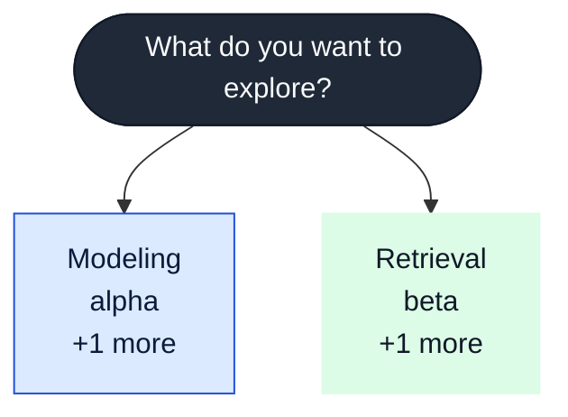
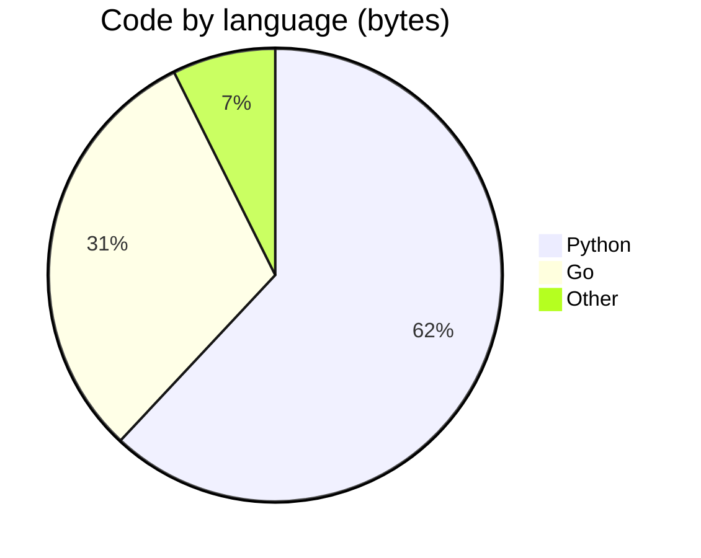

<!-- Generated by profile-forge. Edit the config file, not this file. -->

# Test Person

---

## Find your path

Pick an area to explore. Colors group repositories by category, and the same colors are used in every diagram on this page.

**Legend**

| Color | Category | What it covers | Repos |
|---|---|---|---|
|  | Modeling | Training things. | 2 |
|  | Retrieval | Finding things. | 2 |

---

## Everything, by category

### Modeling 

Training things.

- [alpha](https://github.com/tester/alpha): Alpha model trainer. Python
- [delta](https://github.com/tester/delta) Rust

### Retrieval 

Finding things.

- [beta](https://github.com/tester/beta): Beta retrieval engine, fast and small. Go
- [gamma](https://github.com/tester/gamma): Gamma agent. Python

---

## Languages

Bytes of code per language, summed across public repositories with the GitHub languages API. Forks are excluded.

| Language | Bytes | Share | Repos |
|---|--:|--:|--:|
| Python | 9.9 KiB | 62.0% | 3 |
| Go | 4.9 KiB | 30.7% | 1 |
| Other | 1.2 KiB | 7.4% |  |

Counted 15.9 KiB across 5 repositories.

---

## Releases

| Project | Latest release | Language |
|---|---|---|
| [alpha](https://github.com/tester/alpha) |  | Python |
| [gamma](https://github.com/tester/gamma) |  | Python |
