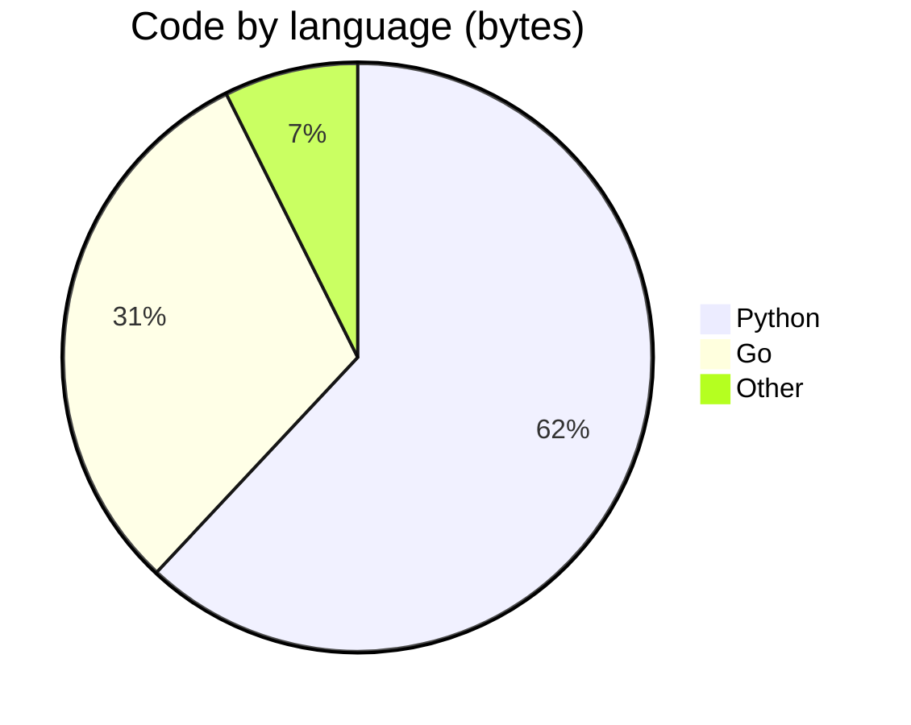

<!-- Generated by profile-forge. Edit the config file, not this file. -->

## Flagship projects

The best ones.

| Project | What it is | Validation and results |
|---|---|---|
| [alpha](https://github.com/tester/alpha)  | Alpha model trainer. | Matches the reference to 1e-9. |
| [beta](https://github.com/tester/beta) | A small search engine | Recall 0.98 at k=10 \| measured. |

---

# Test Person

### Engineer

Builds "careful" systems.

[GitHub](https://github.com/tester)

---

## Languages

Bytes of code per language, summed across public repositories with the GitHub languages API. Forks are excluded.

| Language | Bytes | Share | Repos |
|---|--:|--:|--:|
| Python | 9.9 KiB | 62.0% | 3 |
| Go | 4.9 KiB | 30.7% | 1 |
| Other | 1.2 KiB | 7.4% |  |

Counted 15.9 KiB across the 5 repositories that contain code.

---

Generated for tests.

